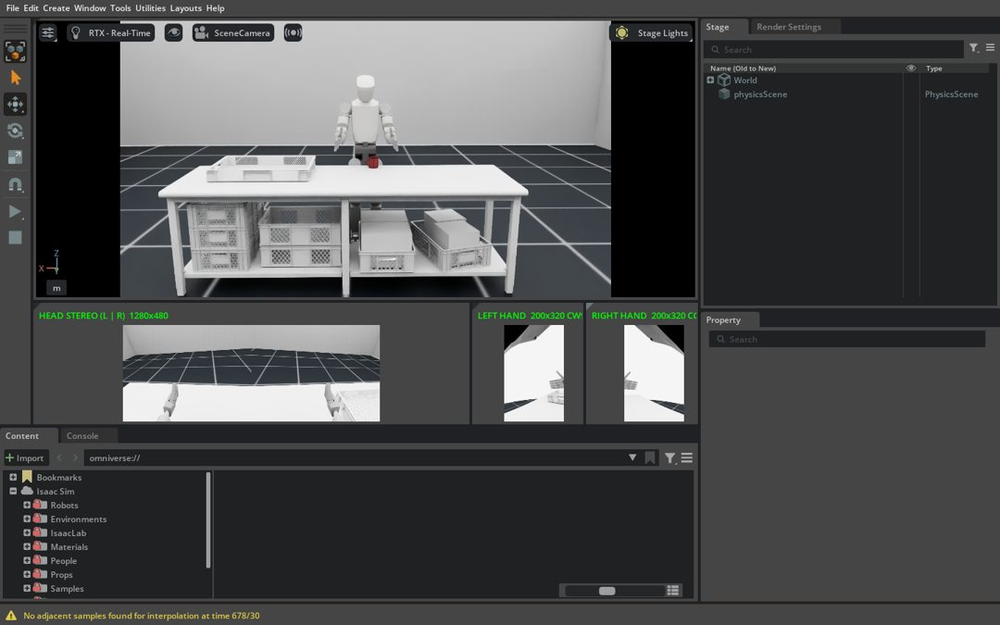

# igris-sim

ROBROS IGRIS-C 시뮬레이션·텔레옵 연구 환경의 **재현용 골격**(스크립트·설정·문서). 외부 소스, 설치본, 캐시, 대용량 자산은 Git에 넣지 않고 `repos.lock`(커밋 고정)과 `assets.sha256`(체크섬)으로 복원·검증한다.

- 현재 상태·검증 여부: [docs/CURRENT_STATE.md](docs/CURRENT_STATE.md) — **실제 검증한 단계와 미검증 단계를 구분**해 기록한다.
- 버전·경로·상세 명령: [docs/SETUP.md](docs/SETUP.md)
- 작업 규칙(안전): [CLAUDE.md](CLAUDE.md) — 실물 명령 송신 금지, DDS/ROS는 루프백 기본값.

## 대상 환경(검증된 조합)

Ubuntu 24.04 x86_64 · NVIDIA 580 드라이버 · ROS 2 Jazzy · Isaac Sim 5.1.0(pip, Python 3.11) · micromamba 환경(`sdk` py3.12 / `gmr` py3.10 / `tools`).
이 저장소는 `~/igris_ws`에 클론하는 것을 전제로 한다(스크립트가 이 경로를 사용).

## 새 PC에서 복원

```bash
git clone https://github.com/jaemin0319/igris-sim.git ~/igris_ws && cd ~/igris_ws
# 0) micromamba(사용자 공간) — docs/SETUP.md §3 참조. tools 환경(git, cmake, gh, redis) 생성
# 1) 외부 저장소를 고정 커밋으로 복원
bash scripts/01_clone_sources.sh
# 2) 시스템 패키지(1회, sudo): ROS 2 Jazzy + 빌드 도구 + XRoboToolkit deb. 드라이버/원격 패키지가 바뀌면 자동 중단
sudo bash scripts/00_sudo_install.sh
# 3) Python 환경(sdk/gmr) — docs/SETUP.md §3, docs/pip_freeze_*.txt
# 4) 자산 체크섬 검증
bash scripts/02_assets_manifest.sh verify
# 5) Isaac Sim 5.1.0 (별도 ext4 권장, 여유 ≥22GB; 설치본 17GB). 공간 검사를 통과해야만 다운로드
ISAAC_ROOT=/mnt/isaac bash scripts/20_install_isaac.sh
# 6) 기존 G1 시뮬 '환경' 자산 확보(비공개 Release 접근 권한 + 복호화 암호 필요, 암호는 pinentry 창에만 입력)
#    download: 23.1GB 받기+SHA-256 검증 → list: 스트리밍 복호화로 목록·크기 산정 → extract: 장면 자산·배치 설정만 1.2GB 추출
bash scripts/30_fetch_vla_scene.sh download && bash scripts/30_fetch_vla_scene.sh list && bash scripts/30_fetch_vla_scene.sh extract
bash scripts/30_fetch_vla_scene.sh forget            # gpg-agent 메모리의 암호 캐시 제거
bash scripts/02_assets_manifest.sh verify            # 추출 자산 포함 84개 SHA-256 대조
# 7) 기존 환경 + IGRIS-C 1대 (GUI, 12초 물리 후 초기 배치로 되돌려 창 유지)
bash scripts/run_igris_vla_scene.sh --secs 12 --hold 3600   # 기본: 몸통(base_link) 월드 고정(지지 상태, 균형 제어 아님) + 팔 접은 자세 + 고개 30° 아래 + 임시 근사 외형 + RGB 카메라 4개 + 하단 모니터. 끄기: --no-fix / --no-appearance / --no-cameras / --no-monitor · 동작 시험: --arm-test
#    카메라 캡처: data/isaac/cameras/<tag>_{static,moving,end}_{head_left,head_right,hand_left,hand_right}.png, *_cam_head_1280x480.png, *_quad_preview.png
#    설치 확인용 빈 장면: bash scripts/run_isaac_igris.sh --secs 5 --hold 60
```

## 현재 기본값과 기준 화면

현재 기본값(상세·근거: [docs/CURRENT_STATE.md](docs/CURRENT_STATE.md) 맨 위 요약):
- **몸통(`base_link`) 월드 고정** — 지지 상태이며 균형 제어가 아니다. 5–7차에 쓰던 골반(`Link_Waist_Pitch`) 고정은 몸통 흔들림 때문에 8차에서 기본값에서 뺐다(`fix.link: auto`로만 재현). `--no-fix`에서는 제어기가 없어 1–2초 내에 넘어진다.
- 팔 접은 대칭 자세, 고개 30° 아래(URDF 한계 ±30°).
- RGB 카메라 4개(머리 좌/우 눈, 좌/우 손바닥) + 하단 실시간 모니터. 모니터의 손 셀만 표시 회전(왼 CW 90°, 오른 CCW 90°), 원본 프레임은 회전하지 않음. 왼손 카메라는 11차 튜닝값 yaw −20°.
- 외형은 공식 스킨이 아닌 임시 근사 재질.



9차 실행 화면(몸통 고정·팔 접음·고개 30°·하단 모니터). 11차의 왼손 카메라 yaw −20°는 headless 캡처로만 확인했고, 적용 후 GUI 전체 창 스크린샷은 아직 없다.

과거 단계 화면(근거 보존):
- 4차 초기 배치(외형·자세·카메라 적용 전, 고정 없음): `docs/img/igris_vla_scene_init_diag.jpg`
- 5차 임시 외형 전/후(당시 골반 고정): `docs/img/igris_before_appearance_diag.jpg`, `docs/img/igris_after_appearance_diag.jpg`
- 6차 카메라 4개 정지/동작(당시 팔 내린 자세): `docs/img/igris_cameras_static_quad.jpg`, `docs/img/igris_cameras_moving_quad.jpg` — 설정·근거 docs/SETUP.md §10
- 7차 하단 모니터(손 셀 회전 전): `docs/img/igris_monitor_window.jpg`
- 8차 기본 자세: `docs/img/igris_pose_window.jpg`, 측면 `docs/img/igris_pose_side.jpg`
- 10–11차 데이터셋 비교·튜닝: `docs/img/dataset_compare/`, `docs/img/tuning/`

## 구성

| 경로 | 내용 | Git |
| --- | --- | --- |
| `scripts/` | 설치·빌드·검증·실행 스크립트, `scripts/isaac/igris_min_scene.py` | 포함 |
| `config/` | 루프백 CycloneDDS XML, GMT 시험용 설정 사본 | 포함 |
| `docs/` | SETUP, CURRENT_STATE, DATASET_SIM_CAMERA_DIAGNOSIS, `results/`(검증 요약 JSON), `img/`, pip freeze | 포함 |
| `repos.lock`, `assets.sha256` | 외부 저장소 커밋, 자산 SHA-256 | 포함 |
| `src/`, `envs/`, `opt/`, `downloads/`, `data/`, `logs/`, `ros2_ws/`, `build/` | 외부 소스·설치본·산출물 | **제외** |
| `config/vla_scene.yaml` | 기존 장면 정의(배치·조명·재질·G1 자리·IGRIS 배치 규칙, 출처 sha256) | 포함 |
| `config/igris_cameras.yaml`, `scripts/isaac/igris_cameras.py` | RGB 카메라 4개(공식 robot_cfg.py 기반, 손 위치 수정 기록, 학습용 640×480 출력) | 포함 |
| `/mnt/isaac` | Isaac Sim 설치본(`env`)·Kit 캐시·`vla-scene/{parts,extracted}`·생성 장면 `scenes/*.usda` | 저장소 밖 |

## 자산 출처·라이선스

- IGRIS-C USD/URDF/정책: `robrosinc/*_public` 저장소(각 저장소 LICENSE 준수, 재배포하지 않고 커밋으로 참조).
- LAFAN1 샘플 BVH: ubisoft-laforge-animation-dataset, CC BY-NC-ND 4.0(비상업 연구용, 재배포 안 함).
- XRoboToolkit PC Service: XR-Robotics 릴리스 v1.0.0 deb.
- 기존 시뮬 환경: 비공개 Release `jaemin0319/vla-recovery-private@snapshot-g1-20260914-E0FK4Q`(GPG 암호화, 체크섬은 `jaemin0319/vla-repro@ca375db`). PackingTable·YCB 머그 등 제3자 자산(Unitree `unitree_sim_isaaclab`, YCB)이 포함되므로 재배포하지 않고 체크섬과 추출 스크립트만 기록한다. 바닥은 Isaac Sim 공식 에셋 서버의 `Grid/default_environment.usd`.
